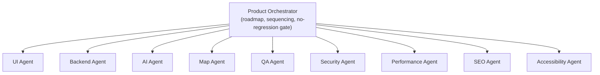

# ChainRoute AI → AI Logistics Operating System
## Strategy, Audit & Implementation Plan

> **Build progress:** ✅ **Sprint 0.5** (dead-code removal + shared `lib/network.ts` dedupe) · ✅ **Sprint 1 — AI Command Center** (composite Health Score, live Alerts, Network Map, Ledger Activity timeline; 8 new tests) · ✅ **Sprint 2 — Digital Twin** (MapLibre + CARTO/OSM, animated shipments, risk zones, geolocation; no secrets). Next up: Sprint 3 (Risk + Optimizer). Sprint 5 (Copilot) remains gated on an LLM key.

> **Status:** Planning deliverable. **No application code was modified to produce this** (Phase 1 rule honored). Every audit claim is grounded in the actual source at the current commit (`main`). Where a statement is reasoning rather than a code fact, it is marked **(inferred)**. Competitor analysis in Phase 2 is **general industry knowledge, not independently re-verified with live sources this session** — no fabricated metrics or pricing are stated.

---

## Table of Contents
1. [Phase 1 — Complete Project Audit](#phase-1--complete-project-audit)
2. [Phase 2 — Product Research](#phase-2--product-research)
3. [Phase 3 — Six Startup MVP Features](#phase-3--six-startup-mvp-features)
4. [Phase 4 — Multi-Agent System](#phase-4--multi-agent-system)
5. [Phase 5 — Implementation Plan (6 Sprints)](#phase-5--implementation-plan-6-sprints)
6. [Phase 6 — Rules & Guardrails](#phase-6--rules--guardrails)
7. [Decision Gate — What Needs You](#decision-gate--what-needs-you)

---

## Phase 1 — Complete Project Audit

### System snapshot (verified)
- **Stack:** Next.js 15.1.3 (App Router) · React 19 · TypeScript strict · Tailwind · framer-motion · recharts · react-hook-form + zod · Vitest.
- **Shape:** **100% client-side.** No `/api` route handlers, no Server Actions, no database, no env vars.
- **Persistence:** browser `localStorage`, per-org namespaced (`chainroute:v1:<scope>:<collection>`), behind a **swappable repository** (`src/lib/db/client.ts` → `collections.ts` → `useCollection`).
- **Auth:** client-side; unique-email signup, session pointer, route guard, RBAC (nav-level). Passwords hashed with a **non-crypto** `simHash` + static salt.
- **"Map":** hand-rolled schematic **SVG** (`src/components/map/world-map.tsx`) — **not** a real geospatial engine. No MapLibre/Cesium/Leaflet/Mapbox present.
- **Ledger:** real hash-chained blocks (`lib/ledger/mint.ts` + `verifyChain`), minted from user shipment events.
- **Analytics/AI:** pure, empty-safe derivations (`lib/analytics/compute.ts`); "AI Insights" is a transparent **rules engine**, not a model.
- **Scale:** 18 route pages · 58 components · 8 hooks · **52 unit tests** · GitHub Actions CI · builds clean (0 warnings, 25 routes).

### Current features (what works)
Marketing site (hero/features/pricing/FAQ/contact), full auth + 3-step onboarding, org/company profile, RBAC nav, dashboard home with computed KPIs + empty states, **CRUD** for warehouses / vehicles (two-way driver linkage) / drivers / customers / shipments / invoices, hash-chained **Ledger Explorer** with `verifyChain`, animated **Simulation**, **Analytics** with CSV export, rules-based **AI Insights**, **Admin** (team/invite/audit/org), **Settings**, **command palette (⌘K)**, real notifications + audit log, opt-in demo-data loader, light/dark themes, security headers, dynamic OG image, sitemap/robots/manifest.

### Missing features (for an "OS", not a dashboard)
Real geospatial map & live location · true route optimization (only schematic animation today) · predictive ML/LLM intelligence (rules only) · live external data (weather/traffic/fuel) · real backend + database + multi-device sync · server-side auth · real-time collaboration · notifications delivery (email/push) · billing · document/PDF export · bulk import (CSV) · webhook/integration surface · offline/PWA.

### Broken / fragile
- **`/verify-otp`** was removed earlier; no current broken routes. **(inferred: none broken — build is green.)**
- **Fragility:** `mintLedgerBlock` reads `repo.all()` which returns `[]` on the server (SSR guard), so it is **client-only correct** — fine in practice but a footgun if ever called during SSR. Documented, not a bug.

### UI problems
- KPI icon tiles are **uniformly indigo** across dashboard/analytics — slightly monotonous vs the richer, multi-tint ledger cards.
- Demo charts look **sparse** with ~2 months of seeded data (data artifact, not a bug).
- Several surfaces (shipments/fleet/customers/admin/settings/simulation/pricing/contact/auth/onboarding) inherit the refreshed design tokens but were **not individually screenshot-verified** in the last pass — consistency is likely but unproven at every breakpoint. **(inferred)**

### UX problems
- No **bulk actions** on tables (select-all/batch delete/status).
- No **global search results** page (⌘K routes to ledger `?q=` only).
- No **undo** on destructive deletes (confirm dialog only).
- Forms are long single-column modals (shipments has ~20 fields) — no sectioning/stepper for the heaviest one.
- No **saved views/filters** persistence.

### Architecture problems
- **Monolithic page components:** `shipments/page.tsx` **1,329 lines**, `fleet` 1,156, `customers` 1,085 — each inlines table + filters + create/edit dialog + detail dialog + delete confirm. High cognitive load; hard to test; duplication across pages.
- **Repeated CRUD-page pattern** (toolbar + table + dialogs + pagination) is copy-adapted per entity rather than abstracted into a reusable `<ResourceTable>` / `<EntityDialog>` (schema-driven).
- **No service/query layer between hooks and pages** for cross-entity joins (e.g. shipment → customer/warehouse names are looked up ad hoc in each page).
- Client-only ceiling: analytics recompute on every render over full arrays (fine at demo scale, not at 100k rows).

### Performance problems
- Feature pages are large client bundles (dashboard first-load JS ~180–470 kB per earlier build output). No route-level `dynamic()` splitting of heavy dialogs/charts.
- recharts + framer-motion are heavy; charts aren't lazy-loaded.
- Full-array recomputation of stats/series on each mutation (no mem0 cache keyed by data version beyond `useMemo`).
- No image optimization needs today (few images), but marketing uses remote avatars.

### Code smells
- Giant page files (above). 
- Duplicated dialog/form scaffolding per entity.
- Mixed select patterns (`NativeSelect` in forms vs Radix `Select` in toolbars) — intentional but inconsistent.
- Some inline arrays of option/label maps that could live in `config/`.

### Security issues
- **Non-crypto password hashing** + client-side auth → not real credential security (documented, intentional demo). A reviewer flags this instantly.
- **No server boundary** → no input validation at a trust boundary, no rate limiting, no authz enforcement beyond UI. All data is attacker-controllable (it's their own browser, so blast radius = self, but the model doesn't generalize).
- **No CSP header** (only the other security headers). 
- Secrets: none today; the moment an LLM/map/weather key is added, it **must** go through a server route — never a `NEXT_PUBLIC_` var.

### Dead code (verified this session)
- `ForecastChart`, `LineForecast` (in `components/charts/index.tsx`) — exported, **never imported**.
- `RiskBadge` + `RISK_META` (`config/status.ts` / `shared/status-badge.tsx`) — leftover from the old fabricated-risk design; risk isn't stored → **unused**.
- `useMediaQuery` (`hooks/use-media-query.ts`) — **unused**.
- `vehicleRunningCost` (`lib/domain/calc.ts`) — exported, **unused**.
- Marketing-only `MetricCard`/`useCounter`/`preview.ts` are used (landing previews) — **not** dead.

### Duplicate code
- Per-entity CRUD scaffolding (toolbar/table/pagination/dialogs) repeated across shipments/warehouses/fleet/customers/admin.
- Money/date formatting call sites repeat `formatCurrency(x, currency)` glue (minor).
- Status→badge mapping logic partially duplicated between `config/status.ts` and inline page maps.

### Technical debt
- Client-only persistence/auth is the load-bearing debt: it caps every "OS-grade" feature (multi-user, real-time, ML, integrations).
- No E2E tests; unit tests cover pure logic only.
- Large components untested (no component tests).

### Module scores (out of 100)

| Module | Score | Rationale |
|---|---:|---|
| Architecture (layering, seams) | **78** | Excellent repository/hook seam; hurt by monolithic pages + no service layer. |
| Data layer / persistence | **72** | Clean, reactive, swappable — but browser-only, no indexes, O(n) scans. |
| Authentication / authz | **45** | Functional flow + guard + RBAC nav; non-crypto hash, client-only, no enforcement. |
| Routing | **90** | App Router groups, system pages, guard, deep-links (`?new=1`) all clean. |
| State management | **82** | `useSyncExternalStore` is elegant + SSR-safe; no cross-entity query layer. |
| UI / design system | **86** | Refreshed engineered aesthetic, tokenized, light/dark; minor monotony/unverified surfaces. |
| Components (feature pages) | **62** | Work well but 1,000+-line monoliths, duplicated scaffolding, untested. |
| Charts / analytics | **80** | Empty-safe, real derivations, tested; not lazy-loaded, 2 dead chart exports. |
| Ledger / simulation | **88** | Genuinely novel, hash-chained, verifiable, unit-tested. |
| Map / geospatial | **35** | Schematic SVG only — no real map, location, tiles, or routing. Biggest gap for the vision. |
| Testing | **68** | 52 solid unit tests + CI; zero component/E2E coverage. |
| DevOps / CI | **80** | GH Actions (typecheck+lint+test+build); no preview envs/coverage gate. |
| Security | **44** | Headers + org isolation + no-self-lockout; no server, no CSP, demo-grade auth. |
| Performance | **70** | Static prerender + fine-grained reactivity; heavy client bundles, no code-splitting. |
| Accessibility | **72** | Labels/aria/focus rings/keyboard on primitives; no formal WCAG-AA audit. **(inferred)** |
| SEO | **85** | Metadata, OG image, sitemap, robots, manifest all present. |
| Documentation | **92** | `summary.md`, `AUDIT.md`, `DEPLOY.md`, `TRANSFORMATION_REPORT.md` — thorough & current. |
| **Overall** | **~70** | A polished, well-documented **product demo** with a novel ledger core — one architectural tier (a real backend + geospatial + intelligence) away from an "OS." |

---

## Phase 2 — Product Research

> General, well-established industry understanding — presented as orientation, not sourced claims.

| Product | Category | Recognized strength | Common gap / weakness |
|---|---|---|---|
| **Flexport** | Freight forwarding + visibility | End-to-end ocean/air forwarding, docs, customs; strong UI | Heavy/enterprise, opinionated workflow, less DIY/self-serve |
| **Project44 / FourKites** | Real-time visibility (RTTVP) | Carrier network breadth, live ETAs, multimodal tracking | Visibility-centric (see, not act); integration-heavy onboarding |
| **Uber Freight** | Digital brokerage | Instant pricing, marketplace liquidity | Brokerage-focused; less a shipper "control tower" |
| **Bringg / Onfleet / Locus** | Last-mile orchestration & routing | Dispatch, route optimization, driver apps | Last-mile scope; less strategic BI / network view |
| **FarEye** | Delivery orchestration | Configurable workflows, predictive ETA | Enterprise config complexity |
| **Shiprocket / Delhivery / Porter / Shadowfax** | India logistics/e-comm | Coverage, COD, pincode serviceability, pricing | Aggregator/ops focus; thinner AI-decisioning + geospatial twin |

### Cross-cutting themes
- The category is largely **visibility-first** ("where is my stuff") and **execution-first** (dispatch/route). Fewer products lead with **prescriptive, explainable AI decisioning** tied to a **live geospatial twin** and a **verifiable event ledger**.
- Trust/auditability of the shipment record is rarely a first-class, user-visible feature.
- SMB self-serve "control tower" experiences are thinner than enterprise ones.

### What we can build that they broadly don't (our wedge)
1. **Verifiable, tamper-evident event ledger as a product surface** — most platforms have logs; few make integrity a visible, verifiable feature. (We already have the core.)
2. **Explainable prescriptive Copilot** — not a chatbot, but an agent that reads your own entities and proposes *specific* actions with the reasoning and the numbers shown.
3. **A living geospatial digital twin** that fuses simulated + (optional) live data and lets you *run what-if simulations* on your actual network.
4. **Multi-objective optimization that surfaces trade-offs** (cost vs CO₂ vs ETA vs risk) as an interactive frontier, not a single "optimize" button.
5. **Zero-onboarding self-serve** — start empty, model your network in minutes, get intelligence immediately (our empty-state-first design already leans this way).

---

## Phase 3 — Six Startup MVP Features

> Each MVP is mapped to the **actual** architecture. Complexity is rated honestly given today's zero-backend baseline; items needing a server/secret are flagged. Recommended build order is in Phase 5.

### MVP 6 — AI Command Center *(build first — no secrets)*
- **Problem:** The dashboard shows numbers; operators need a *decision surface* that tells them what's wrong and what to do, live.
- **Target users:** Ops managers, dispatchers, founders running their own logistics.
- **Why others fall short:** Visibility tools show state; they rarely fuse KPIs + map + alerts + recommendations + a live event stream into one "mission control."
- **Solution:** Recompose `/dashboard` into a Command Center: live KPI header, a network map panel, a real-time event/alert rail (driven by the existing simulation tick + audit/notifications), a prioritized recommendation stack (from the rules engine), and an org **Health Score** (composite of on-time %, utilization, integrity, risk).
- **Architecture:** Frontend-only. New `features/command-center/` composing existing hooks; a `useHealthScore()` derived metric; a lightweight `useLiveTicker()` bridging `useSimulation` events into an alert feed.
- **Frontend flow:** grid of live widgets → each subscribes to `useOrgData()`/`useCollection`/simulation; click-through to the source module.
- **Backend flow:** none (client derivations).
- **DB changes:** none (add a derived `healthScore` only).
- **APIs:** none.
- **Complexity:** **M.** **Business value:** High (daily driver). **Demo value:** Very high (the "wow" homepage). **Investor value:** High. **Future:** plug live data + Copilot into the same shell.

### MVP 2 — Live Logistics Digital Twin *(build second — free tiles, optional keys)*
- **Problem:** The schematic SVG can't show real geography, location, or routes.
- **Target users:** Everyone; the signature demo artifact.
- **Why others fall short:** Twins are usually read-only tracking; few let you *simulate* your own network and toggle risk/weather/traffic layers.
- **Solution:** Replace/augment the SVG with **MapLibre GL + OpenStreetMap tiles** (no key required). Plot warehouses/customers (geocode entered cities via a free/opt-in geocoder or a bundled city→lat/lng table), animate shipment routes with ETA progress, layer risk zones, and a **what-if simulation mode** (delay a lane, close a hub, see downstream impact). Request geolocation to center on the user. Fall back to simulated data when live is unavailable.
- **Architecture:** New `features/twin/` with a `MapCanvas` (MapLibre), a `geo` service (city→coord resolver; browser Geolocation), a `layers/` set (routes, risk, weather-optional). Reuse `useSimulation` for movement + ledger minting.
- **Frontend flow:** map loads → entities plotted → play/pause/speed → inspect node/route → toggle layers → run scenario.
- **Backend flow:** optional Next Route Handler proxy for weather/traffic tiles to hide keys.
- **DB changes:** add optional `lat/lng` (+ `geocodedAt`) to `Warehouse`/`Customer`; store on create/edit.
- **APIs:** OSM raster/vector tiles (free); **optional** OpenWeather/traffic (**key → server route**).
- **Complexity:** **L.** **Business value:** High. **Demo value:** Highest. **Investor value:** Very high. **Future:** CesiumJS 3D globe, live carrier feeds, geofencing.

### MVP 3 — AI Risk Prediction *(heuristic first, ML/LLM later)*
- **Problem:** Delays/disruptions are seen after the fact.
- **Target users:** Ops/planners.
- **Why others fall short:** Risk scores are often opaque; confidence and drivers aren't shown.
- **Solution:** A `risk` service that scores each active shipment for late-delivery / weather / route / warehouse-congestion / demand-spike risk, each with a **confidence** and the **contributing factors**. Start explainable-heuristic (distance vs ETA slack, mode, origin utilization, historical status mix); upgrade the same interface to a model/LLM later.
- **Architecture:** `lib/risk/score.ts` (pure, testable) → surfaced in Command Center + shipment detail + a Risk board. Confidence = calibrated heuristic band now, model prob later.
- **DB changes:** none (derived); optionally cache `riskSnapshot` per shipment.
- **APIs:** none (heuristic) → optional weather (server route) + LLM (server route) later.
- **Complexity:** **M** (heuristic) / **L** (model). **Demo value:** High (confidence chips). **Investor value:** High. **Future:** train on accumulated ledger history.

### MVP 4 — Smart Route Optimizer *(multi-objective; algorithmic)*
- **Problem:** Shortest path ≠ best path.
- **Target users:** Dispatchers/planners.
- **Why others fall short:** Single "optimize" button hides trade-offs.
- **Solution:** Multi-objective optimizer over cost / fuel / traffic / weather / priority / driver availability / road restrictions / **CO₂**, presented as an **interactive trade-off frontier** (pick your weighting; see the resulting route + numbers). Use a real routing engine (**OSRM/GraphHopper/Valhalla** — self-host or public demo) for geometry; layer our scoring on top. Deterministic simulated fallback.
- **Architecture:** `lib/optimize/` (scoring + Pareto selection, pure & testable) + a routing adapter (server route to hide any key). Renders on the Twin map.
- **DB changes:** persist chosen `routePlan` on shipment (waypoints, objective weights, scores).
- **APIs:** OSRM (free demo) or self-host; optional traffic/weather (server routes).
- **Complexity:** **L.** **Demo value:** Very high (drag a weight, watch the route + CO₂ change). **Investor value:** High. **Future:** fleet-wide VRP, live re-routing.

### MVP 5 — Business Intelligence Engine *(reports; heuristic → LLM narrative)*
- **Problem:** Data exists; insight/narrative doesn't.
- **Target users:** Founders/execs/ops leads.
- **Why others fall short:** Dashboards, not decisions; no auto-generated narrative.
- **Solution:** Auto-generated **daily/weekly/monthly** reports: cost optimization, warehouse & fleet utilization, customer trends, revenue insights, and **hidden bottleneck detection** — each a computed section with an optional AI-written narrative summary and a **PDF/print export**. Deterministic computation first (already have the aggregations), narrative via LLM later.
- **Architecture:** `lib/reports/` (pure section builders reusing `compute.ts`) + a `ReportView` (print-styled) + export. Narrative = server LLM route (optional).
- **DB changes:** optional saved `reports` collection (snapshotted numbers + generatedAt).
- **APIs:** none (compute) → optional LLM (server route) for prose.
- **Complexity:** **M.** **Demo value:** High. **Investor value:** Very high (this is the "board deck" generator). **Future:** scheduled email delivery, anomaly alerts.

### MVP 1 — AI Logistics Copilot *(build last — needs LLM key + server route)*
- **Problem:** Operators need an expert that knows *their* network and proposes concrete actions.
- **Target users:** All roles (scoped by RBAC).
- **Why others fall short:** Generic chatbots don't have grounded, structured context or prescriptive, explainable actions.
- **Solution:** A Copilot grounded in the org's real entities (shipments, fleet, warehouses, ledger, risk, reports). It **proactively** proposes actions ("Re-route CR-100014 via rail — saves $420 and 62% CO₂; ETA +6h") with the numbers and a one-click apply that writes through `useCollection`/`mintLedgerBlock` and logs an audit entry. Tool-use over our own repository/compute functions, not free text.
- **Architecture:** **Requires a Next Route Handler** (`app/api/copilot/route.ts`) holding the model key (Anthropic/OpenAI) + a **context builder** (serialize relevant, RBAC-filtered slices) + a **tool schema** mapping to real mutations (server proposes, client applies with confirmation). Memory via a `copilotThreads` collection.
- **DB changes:** `copilotThreads`/`messages`; optional `actions` audit tie-in.
- **APIs:** **LLM key (secret → server route).** Optional retrieval over reports/risk.
- **Complexity:** **XL.** **Demo value:** Highest. **Investor value:** Highest (this is the "AI OS" story). **Future:** multi-step autonomous workflows with human-in-the-loop approval.

---

## Phase 4 — Multi-Agent System

> A **development/operations** agent model (how work + runtime responsibilities are divided). Runtime "agents" (Copilot tools) are a subset.

| Agent | Charter | Owns (files/areas) | Definition of done |
|---|---|---|---|
| **UI** | Consistency, motion, empty/loading/error states, design tokens | `components/ui`, `shared`, `styles`, feature UIs | Token-only styling; every state designed; screenshot-verified light+dark |
| **Backend** | Introduce **Next Route Handlers**, caching, validation, authz, scalability seams | `app/api/*`, `lib/db`, `lib/server/*` | Zod-validated boundaries; secrets server-only; no client key leaks |
| **AI** | Context building, prompts, tool schemas, risk/report heuristics, memory | `lib/risk`, `lib/reports`, `lib/copilot`, `app/api/copilot` | Grounded, RBAC-scoped context; explainable outputs; tests on pure parts |
| **Map** | Geolocation, MapLibre, tiles, routing adapter, twin layers | `features/twin`, `lib/geo`, routing adapter | Real map renders; entities geocoded; simulated fallback; no key in client |
| **QA** | Component + E2E tests, edge cases, regressions | `*.test.ts(x)`, `e2e/` (Playwright) | Green CI; critical flows covered; no console errors |
| **Security** | OWASP pass, authz, rate limiting, input validation, secrets, CSP | `app/api/*`, middleware, headers | Server boundary validated; CSP added; secrets audited |
| **Performance** | Code-splitting, lazy charts/dialogs, memoization, bundle budget | route configs, `dynamic()` | Lighthouse targets; reduced first-load JS; lazy heavy deps |
| **SEO** | Metadata, OG, structured data, sitemap | `app/*`, `metadata` | Rich results valid; per-page metadata |
| **Accessibility** | Keyboard, SR labels, contrast, focus | all interactive UI | WCAG-AA contrast; full keyboard paths; audited |

**Orchestration rule:** the Orchestrator never lets two agents edit the same file concurrently; shared foundations (tokens, data layer, route-handler conventions) land first, then leaf work fans out — exactly how this repo's prior parallel builds were run.

---

## Phase 5 — Implementation Plan (6 Sprints)

> Sequenced to (a) never break what works, (b) deliver demo value early with **no secrets**, (c) introduce the backend seam once, (d) gate LLM work behind a single decision.

### Sprint 0.5 (pre-work, ~0.5 day) — Debt paydown *(no secrets)*
- **Objectives:** Remove verified dead code; extract the reusable CRUD scaffold to shrink the 1,000+-line pages.
- **Files:** delete/trim `ForecastChart`,`LineForecast`,`RiskBadge`/`RISK_META`,`useMediaQuery`,`vehicleRunningCost`; add `components/data/ResourceTable.tsx` + `EntityDialog.tsx`; refactor one page (customers) onto them as the pattern.
- **Deps:** none. **Testing:** unit tests for the scaffold; build green. **Deliverable:** −1 dead export set, −~400 lines on the pilot page.

### Sprint 1 — MVP 6: AI Command Center *(no secrets)*
- **Objectives:** Ship the mission-control homepage + Health Score + live event rail.
- **Files:** `features/command-center/*`, `hooks/use-health-score.ts`, `hooks/use-live-ticker.ts`, rework `app/dashboard/page.tsx`.
- **Deps:** none. **Testing:** unit-test health-score math; visual verify light+dark; a11y pass. **Deliverable:** the new "wow" dashboard.

### Sprint 2 — MVP 2: Digital Twin (MapLibre + OSM) *(free tiles)*
- **Objectives:** Real map, geolocation, plotted entities, animated routes, layer toggles, what-if mode.
- **Files:** `features/twin/*`, `lib/geo/*` (city→coord + Geolocation), add `lat/lng` to Warehouse/Customer types + forms; replace SVG usage in `/dashboard/simulation` (keep SVG as fallback).
- **Deps:** `maplibre-gl`. **Testing:** geocode resolver unit tests; render + interaction QA. **Deliverable:** the signature demo artifact.

### Sprint 3 — MVP 3 + MVP 4: Risk + Optimizer *(algorithmic; optional routing key via server)*
- **Objectives:** Explainable risk scores (confidence + drivers) and multi-objective route optimization with a trade-off frontier, both rendered on the twin.
- **Files:** `lib/risk/*`, `lib/optimize/*` (pure, tested), Risk board + Optimizer panel; **introduce `app/api/route/route.ts`** (routing/geometry proxy) — the **first Route Handler** (establishes the backend seam & secret pattern).
- **Deps:** OSRM/GraphHopper (public/self-host). **Testing:** heavy unit tests on scoring/Pareto; E2E on optimize flow. **Deliverable:** prescriptive routing + risk.

### Sprint 4 — MVP 5: BI Engine *(compute; PDF)*
- **Objectives:** Auto daily/weekly/monthly reports with bottleneck detection + print/PDF export.
- **Files:** `lib/reports/*`, `features/reports/ReportView`, export util; optional `reports` collection.
- **Deps:** print CSS (+ optional `@react-pdf` later). **Testing:** unit-test section builders; snapshot report numbers. **Deliverable:** board-ready reports.

### Sprint 5 — MVP 1: AI Copilot *(GATED: needs LLM key + backend)*
- **Objectives:** Grounded, prescriptive, tool-using Copilot with apply-with-audit + memory.
- **Files:** `app/api/copilot/route.ts`, `lib/copilot/{context,tools,memory}.ts`, Copilot UI, `copilotThreads` collection; add server-side auth check to protect the route.
- **Deps:** Anthropic/OpenAI SDK + **API key (your decision/secret)**; env config; likely a real session/auth hardening pass alongside. **Testing:** unit-test context builder + tool mappers; E2E on propose→apply. **Deliverable:** the "AI OS" headline feature.

### Sprint 6 — Hardening: Security · Performance · A11y · SEO · QA
- **Objectives:** OWASP pass on the new routes, CSP, rate limiting; code-split heavy charts/dialogs + lazy MapLibre; full keyboard/contrast audit; structured data; component + E2E coverage; Lighthouse budget in CI.
- **Files:** `middleware.ts`, `next.config.mjs` (CSP), `dynamic()` boundaries, `e2e/*`, metadata.
- **Deps:** Playwright, `@next/bundle-analyzer`. **Testing:** Lighthouse + axe in CI. **Deliverable:** production-grade posture.

**Dependency graph:** 0.5 → 1 → 2 → 3 → (4 ∥ can start) → **5 (gated)** → 6. Sprints 1–4 ship a compelling, fundable product **with zero secrets**; Sprint 5 unlocks the full "AI OS" narrative once a key is provided.

---

## Phase 6 — Rules & Guardrails

Enforced throughout (these match how this repo has been maintained):
- **Never break existing functionality** — additive features; keep the SVG twin as fallback until MapLibre is proven; guard every refactor with the build + 52 tests + CI.
- **Test before merging** — `typecheck → lint → test → build` is the CI gate; add tests with each pure module (risk/optimize/reports/health-score) and E2E for new flows.
- **Refactor only with clear benefit** — extract `ResourceTable`/`EntityDialog` (real duplication) before adding new CRUD; don't rewrite what works.
- **Modular, no duplication, clean architecture** — new logic goes in pure `lib/*` (testable) behind hooks; UI stays token-only; secrets only in `app/api/*`.
- **Production-quality code, minimal comments, token-efficient** — small typed functions, descriptive names, comments only for non-obvious "why."
- **Never rewrite the whole project for a small change** — every MVP above is an addition on top of the existing seams (`useCollection`, `compute`, `mintLedgerBlock`, design tokens).

---

## Decision Gate — What Needs You

I can proceed autonomously on **Sprints 0.5 → 4** (Command Center, Digital Twin, Risk, Optimizer, BI) with **no secrets and no irreversible choices**. Before Sprint 5 (Copilot) and the optional live layers, I need one decision each:

1. **LLM provider + key** for the Copilot and AI narratives (Anthropic recommended). This introduces the first server route + an env secret. *Without it, MVP 1/5-narrative stay heuristic.*
2. **Live-data keys (optional):** weather/traffic for the twin, and a hosted routing engine (or accept OSRM public/self-host). *Without them, we use realistic simulated layers — which is fully acceptable for demo/hackathon.*
3. **Backend/database direction (optional but strategic):** stay client-only (great demo, zero infra) vs. introduce Supabase/Postgres for multi-user/real-time/persistence. The repository seam (`lib/db/client.ts`) makes this a contained swap. *This is the one choice that meaningfully changes "product direction," so I'll ask before doing it.*

**My recommendation:** start now with **Sprint 0.5 + Sprint 1 (Command Center)** and **Sprint 2 (MapLibre Digital Twin)** — both are pure frontend, need nothing from you, and deliver the biggest demo/investor jump. Say the word and I'll begin implementing, one sprint at a time, verifying against the CI gate after each.
