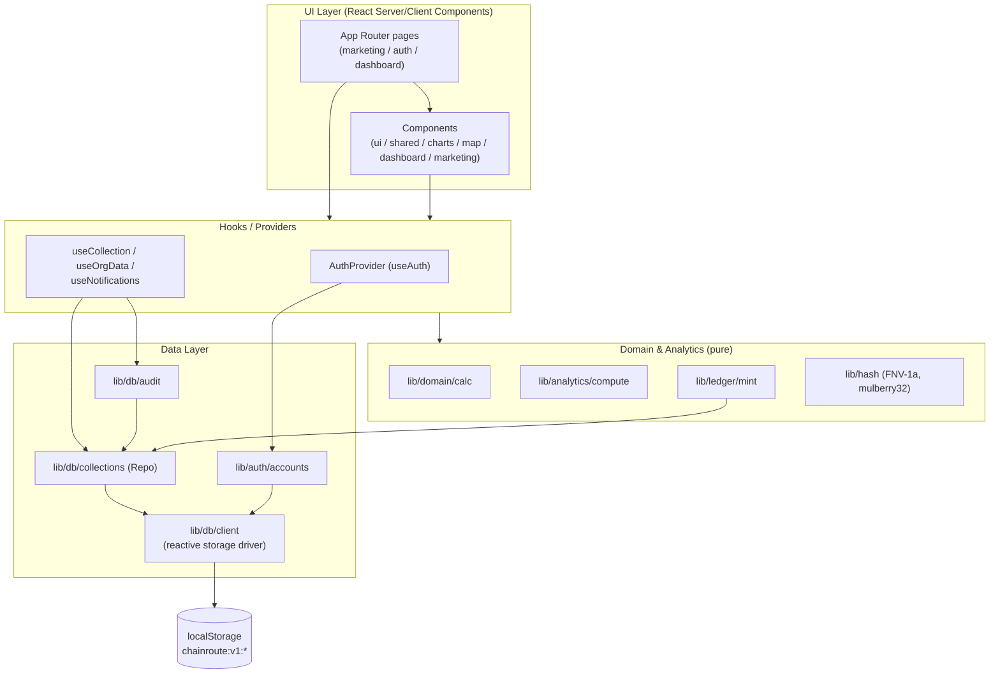
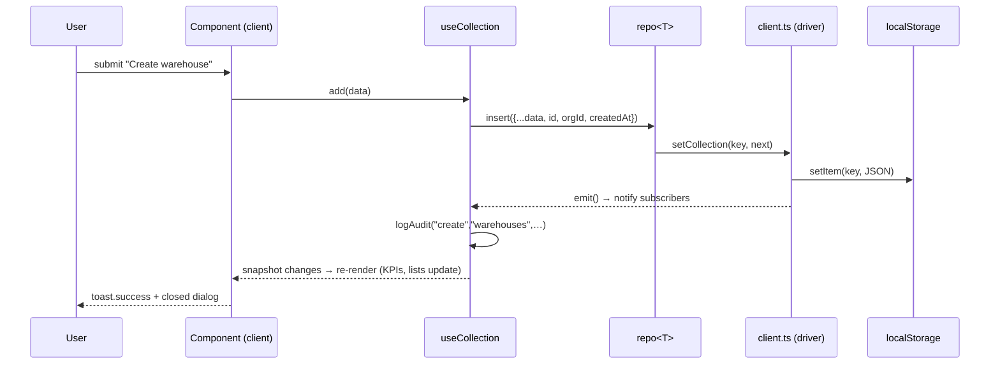
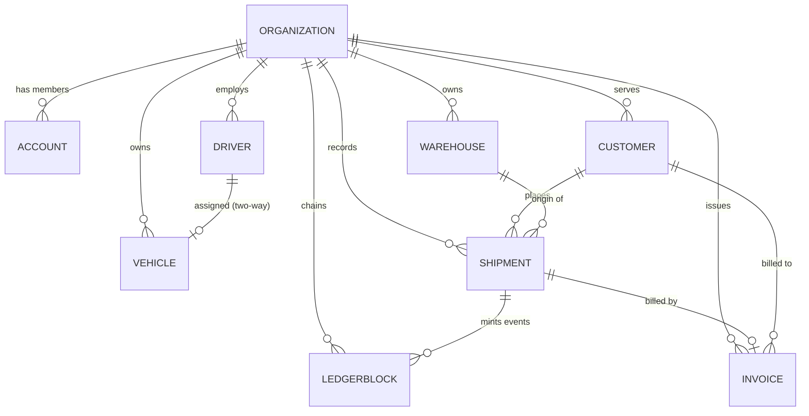
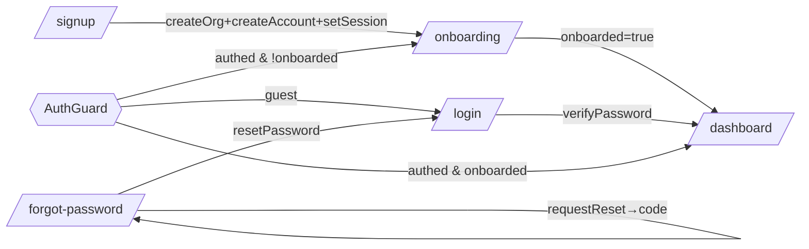
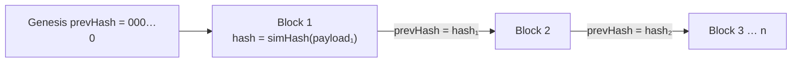

# ChainRoute AI — Project Knowledge Document

> A self-contained reference for AI assistants and engineers. It describes the **actual, current** state of the codebase (read from source, not assumed). Anything not directly verifiable in code is explicitly marked **(inferred)**.

---

## Table of Contents

1. [Project Summary](#project-summary)
2. [Features](#features)
3. [Architecture](#architecture)
4. [Tech Stack](#tech-stack)
5. [Application Flow](#application-flow)
6. [Components / Modules](#components--modules)
7. [API Documentation](#api-documentation)
8. [Database (Data Layer)](#database-data-layer)
9. [Authentication & Authorization](#authentication--authorization)
10. [Configuration](#configuration)
11. [Dependencies](#dependencies)
12. [External Integrations](#external-integrations)
13. [Important Algorithms](#important-algorithms)
14. [Coding Patterns](#coding-patterns)
15. [Build & Run Instructions](#build--run-instructions)
16. [Testing](#testing)
17. [Current Limitations](#current-limitations)
18. [Improvement Opportunities](#improvement-opportunities)
19. [AI Development Context](#ai-development-context)
20. [Glossary](#glossary)

---

## Project Summary

- **Project name:** ChainRoute AI — *Decentralized Logistics Intelligence Platform*
- **Package name:** `chainroute-ai` (v1.0.0, private)
- **Purpose:** An AI-flavored logistics SaaS where a company manages its warehouses, fleet, drivers, customers, shipments, and invoices, and gets **dynamically computed** analytics plus an **immutable, hash-chained shipment ledger** ("Blockchain Simulation Mode" — a decentralized *simulation*, explicitly **not** a real blockchain).
- **Problem it solves:** Traditional logistics tooling has poor transparency, mutable shipment history, weak delay/risk insight, and clunky UX. ChainRoute AI provides tamper-evident shipment events (hash-chained ledger), transparent rules-based insights, live analytics derived only from real records, and a premium, accessible UI.
- **High-level overview:** A **Next.js 15 (App Router) + React 19 + TypeScript** application that is **100% client-side** — there is **no backend, no database server, no API routes, and no environment variables**. All business data is user-entered and persisted per-organization in the browser's `localStorage` behind a **swappable repository abstraction**, so the app deploys to Vercel/Netlify/any Node host with zero configuration. The design language is **"engineered surface"** — hairline borders + restrained single-source elevation, tight radii, a disciplined indigo/teal palette, and gradient used only as a rare accent (Linear/Vercel/Stripe school), with full light/dark theming.

> **Design-token note for maintainers:** the utility/semantic class names are still `clay`, `shadow-clay*`, `clay-inset`, etc. (kept for continuity), but they no longer render puffy dual-tone "claymorphism" — they now render crisp bordered surfaces with subtle elevation. Don't reintroduce puffy shadows, mesh gradients, or oversized radii. See `src/styles/globals.css` + `tailwind.config.ts`.

**Critical mental model:** The app starts **empty**. Nothing is fabricated. Users create records; analytics, the ledger, KPIs, and insights are all **derived** from those records. There is an **opt-in** "Load demo data" button for hosted previews.

---

## Features

### Implemented (verified in code)

**Marketing site** (`src/app/(marketing)/`)
- Landing page composed of sections: hero, logos, features, why-decentralized, AI, simulation preview, dashboard preview, testimonials, pricing preview, FAQ, CTA.
- `/pricing` (monthly/annual toggle) and `/contact` (validated form).
- Fixed navbar with scroll state + mobile menu; footer with working external social links.

**Authentication & onboarding**
- `/signup` (creates organization + admin account), `/login`, `/forgot-password` (functional reset with on-screen code since email is simulated), 3-step `/onboarding` wizard (company profile → address → finish).
- Client route guard, session persistence, logout, authenticated-user redirect away from `/login` & `/signup`.
- Role selection (5 roles) and role-based nav filtering.

**Dashboard modules** (`src/app/dashboard/*`) — all data-driven with empty states:
- **Home → AI Command Center** (`/dashboard`): "Mission Control" — a composite **org Health Score** (`lib/health/score.ts`, weighted + empty-safe), a **live Alerts** rail (`lib/alerts/derive.ts`, real computed conditions), a **Network Map** panel, a **Ledger Activity** timeline, live KPI grid, charts, recommendations, and the first-run quick-start empty state. Wired by `useCommandCenter`.
- **Digital Twin** (`/dashboard/twin`): a real interactive geospatial map (**MapLibre GL** + theme-matched CARTO/OpenStreetMap basemaps, no API key) mirroring the network — warehouse hubs, destination cities, animated multimodal shipment markers, derived risk zones, layer toggles, play/pause/speed, browser geolocation, click-to-inspect. Coordinates derived deterministically (`buildGeoModel`/`geoForName` in `lib/network.ts`); the map lazy-loads via `next/dynamic` (not in the main bundle).
- **Risk Radar** (`/dashboard/risk`): explainable heuristic risk scoring (`lib/risk/score.ts`) for every active shipment — 0–100 composite across 5 weighted, transparent factors (status, schedule pressure, mode exposure, origin congestion, SLA priority), with a confidence band and per-factor breakdown. Filterable board + distribution chart + value-at-risk summary. No black box; deterministic and pluggable for a future model.
- **Route Optimizer** (`/dashboard/optimizer`): multi-objective lane optimizer (`lib/optimize/plan.ts`) generating one candidate per transport mode, scored against user-weighted cost/time/CO₂/reliability, with the **Pareto frontier** computed and visualized as a cost-vs-transit scatter. Interactive sliders + presets (Cheapest/Fastest/Greenest) recompute live.
- **Reports** (`/dashboard/reports`): auto-generated daily/weekly/monthly BI reports (`lib/reports/build.ts`) — executive summary, cost optimization (top lanes, cost/km), fleet + warehouse utilization, customer trends, and automatic **hidden-bottleneck detection** (capacity, exceptions, fleet maintenance, lane concentration). Genuine PDF export via `window.print()` with a dedicated print stylesheet (sidebar/topbar hidden). All figures deterministic; an AI-narrative layer is a documented future upgrade.
- **Shipments**: full CRUD + cost breakdown (freight/fuel/packaging/insurance/other + GST), live total, status "advance", per-shipment ledger timeline, **mints a ledger block on create and on status change**.
- **Warehouses**: CRUD, capacity/utilization, service areas, utilization bar chart.
- **Fleet**: vehicles + drivers CRUD with **two-way driver↔vehicle linkage**, fuel/maintenance, utilization donut.
- **Customers**: CRUD + invoices tab (create invoice, optionally prefilled from a shipment's cost).
- **Ledger Explorer**: block list, search/filter, pagination, `verifyChain` integrity check, block detail with full hashes.
- **Simulation**: animated SVG world map driven by the user's active shipments; play/pause/speed/reset; mints ephemeral session ledger events.
- **Analytics**: KPI strip + tabbed charts (performance, cost & revenue, sustainability/CO₂, fleet & warehouse); **CSV export** built from real records.
- **AI Insights**: transparent **rules-based** engine (no fabricated predictions) computing conditions from real data.
- **Admin**: real platform metrics, team management (invite/role/suspend, no self-lockout), org profile edit, audit log.
- **Settings**: profile, organization, appearance (theme), notifications (persisted prefs), security (change password, 2FA toggle), and a **Data** tab (load demo data / reset workspace).

**Cross-cutting**
- Command palette (`Cmd/Ctrl+K`) with navigation + quick "create" deep-links + theme toggle + sign out.
- Real notifications (bell dropdown) + audit logging on every mutation.
- Light/Dark/System theme, persisted, theme-aware charts/tables/dialogs.
- Professional empty states, loading skeletons, error boundary, styled 404.
- SEO: metadata, `robots.ts`, `sitemap.ts`, `manifest.ts`, dynamic OG image, security headers.

### Incomplete / partial / orphaned

- **`/verify-otp`** (`src/app/(auth)/verify-otp/page.tsx`): a working 6-digit OTP UI, but **orphaned** — no page links to it (the forgot-password flow was reworked into a self-contained 2-step reset). It redirects to `/dashboard` on submit. **(Technical debt.)**
- **Social login buttons** (`src/components/auth/social-buttons.tsx`): UI only; they emit an informational toast ("demo").
- **Marketing previews** (`dashboard-preview`, `simulation-preview`): intentionally use a small **isolated illustrative sample** (`src/lib/data/preview.ts`) — clearly a landing-page product illustration, never used inside the authenticated app.
- **Contact / pricing CTAs**: forms validate + toast; there is no email/payment backend.

### Future-ready components already present

- **Swappable storage driver** (`src/lib/db/client.ts`) — the single seam to move from `localStorage` to a real DB/API.
- **Repository + collection abstraction** (`src/lib/db/collections.ts`, `hooks/use-collection.ts`) — feature code never touches storage directly.
- **Pluggable insight engine** — the AI page is rules-based but structured so a real model endpoint could replace the computation.
- **Pricing tiers** exist on the marketing side, ready for a billing integration.

---

## Architecture

### Overall architecture

A **layered, client-only** architecture. UI → hooks → services/domain logic → repository → storage driver. The storage driver is the only place that knows about `localStorage`.



### Design patterns used

- **Repository pattern** — `repo<T>(scope, name)` returns a typed CRUD interface over one namespaced collection.
- **Provider/Context** — `AuthProvider` exposes auth state + actions via `useAuth()`.
- **External store subscription** — `useSyncExternalStore` gives SSR-safe, fine-grained reactivity (each collection has a stable snapshot reference that changes only on mutation).
- **Compound components** — Radix-based primitives (`Dialog`, `Select`, `Tabs`, etc.) in `components/ui`.
- **Variant-driven styling** — `class-variance-authority` (`Button`, `Badge`).
- **Pure derivation** — analytics/costing/emissions are pure functions of input arrays (no side effects, empty-safe).
- **Seam/adapter** — `lib/db/client.ts` isolates the persistence engine for later swap.
- **Deterministic generation** — seeded PRNG (`mulberry32`) + non-crypto hash (`FNV-1a`) keep SSR/CSR renders identical and the demo seeder reproducible.

### Folder structure

```
/
├─ docs/                      # AUDIT.md, DEPLOY.md, TRANSFORMATION_REPORT.md
├─ public/                    # (static assets; icon is app/icon.svg)
├─ src/
│  ├─ app/                    # Next.js App Router (routes, layouts, system pages)
│  │  ├─ (marketing)/         # public site: /, /pricing, /contact (+ layout w/ navbar+footer)
│  │  ├─ (auth)/              # /login /signup /forgot-password /verify-otp (+ minimal layout)
│  │  ├─ dashboard/           # authed app: home + 11 modules (+ layout w/ guard, sidebar, topbar, command palette)
│  │  ├─ onboarding/          # 3-step post-signup wizard (outside dashboard shell)
│  │  ├─ layout.tsx           # ROOT layout: fonts, ThemeProvider, AuthProvider, Toaster, metadata
│  │  ├─ loading.tsx / error.tsx / not-found.tsx
│  │  ├─ manifest.ts / robots.ts / sitemap.ts / icon.svg / opengraph-image.tsx
│  ├─ components/
│  │  ├─ ui/                  # ~21 Radix/shadcn-style primitives (Button, Card, Dialog, Table, …)
│  │  ├─ shared/              # PageHeader, EmptyState, StatusBadge, HashBadge, MetricCard, motion
│  │  ├─ charts/              # Recharts wrappers (AreaTrend, BarStat, DonutChart, RadialGauge, …)
│  │  ├─ map/                 # world-map.tsx (schematic SVG world map + animated routes)
│  │  ├─ dashboard/           # shell + panels: sidebar, topbar, auth-guard, command-palette,
│  │  │                       #   stat-card, demo-data, activity-feed, insights-panel, live-shipments
│  │  ├─ form/                # field.tsx (Field + NativeSelect)
│  │  ├─ marketing/           # navbar, footer, sections/*
│  │  ├─ auth/                # auth-shell, role-select, social-buttons
│  │  ├─ brand/               # logo, theme-toggle
│  │  └─ providers/           # theme-provider, auth-provider
│  ├─ hooks/                  # use-collection, use-org-data, use-notifications, use-hotkey,
│  │                          #   use-simulation, use-mounted, use-media-query, use-counter
│  ├─ lib/
│  │  ├─ db/                  # client (driver), collections (repo), types, audit, seed
│  │  ├─ auth/                # accounts (account/org/session store + password hashing)
│  │  ├─ analytics/           # compute (stats + time series, all empty-safe)
│  │  ├─ domain/              # calc (shipment cost, CO₂, reference numbers)
│  │  ├─ ledger/              # mint (hash-chained block minting + verifyChain)
│  │  ├─ data/                # preview (marketing-only illustrative sample)
│  │  ├─ geo.ts               # world hubs + lat/lng → x/y projection
│  │  ├─ hash.ts              # FNV-1a simHash, simSignature, mulberry32 seededRandom
│  │  ├─ utils.ts             # cn, formatters (currency/number/date/relative), truncateHash, initials
│  │  └─ validators.ts        # zod schemas (login/signup/forgot/otp)
│  ├─ config/                 # nav, options (select lists), status (badge meta), user (role labels)
│  ├─ types/                  # index.ts (shared enums + view types: KpiMetric, TimeSeriesPoint, SimNode/Route…)
│  └─ styles/                 # globals.css (Claymorphism tokens for light+dark)
├─ next.config.mjs            # security headers, image remote patterns, package-import optimization
├─ tailwind.config.ts         # theme tokens, clay shadows, keyframes/animations
├─ tsconfig.json              # strict TS, @/* → src/*
├─ components.json            # shadcn config
└─ package.json
```

### Important files and why they exist

| File | Why it exists |
|---|---|
| `src/lib/db/client.ts` | **The only module that touches `localStorage`.** Reactive, SSR-safe driver. Swap this to go to a real DB. |
| `src/lib/db/collections.ts` | Generic typed `Repo<T>` CRUD over a namespaced key. |
| `src/lib/db/types.ts` | The canonical domain model (Organization, Account, Warehouse, Vehicle, Driver, Customer, Shipment, LedgerBlock, Invoice, AuditLog, AppNotification). |
| `src/hooks/use-collection.ts` | Reactive per-collection CRUD bound to current org; auto-fills `id/orgId/createdAt` and writes an audit log on every mutation. |
| `src/hooks/use-org-data.ts` | One-call reactive read of all collections + computed `stats`. |
| `src/components/providers/auth-provider.tsx` | Auth state + all auth actions (`useAuth`). |
| `src/lib/ledger/mint.ts` | Hash-chained ledger block minting + chain verification. |
| `src/lib/analytics/compute.ts` | All KPI/series derivations (empty-safe). |
| `src/app/layout.tsx` | Root providers (Theme + Auth), fonts, global toaster, base metadata. |
| `src/styles/globals.css` | Claymorphism design tokens (CSS variables) for light + dark. |

---

## Tech Stack

- **Language:** TypeScript 5.7 (strict), TSX/JSX. CSS via Tailwind.
- **Framework:** Next.js 15.1.3 (App Router, RSC), React 19 + React DOM 19.
- **UI / styling:** Tailwind CSS 3.4, `tailwindcss-animate`, Radix UI primitives, `class-variance-authority`, `clsx`, `tailwind-merge`, `next-themes`, `lucide-react` (icons), `sonner` (toasts).
- **Animation:** `framer-motion` 11.
- **Charts:** `recharts` 2.15.
- **Forms & validation:** `react-hook-form` 7.54 + `@hookform/resolvers` + `zod` 3.24.
- **Build tools:** Next build (Turbopack/Webpack via `next`), PostCSS + Autoprefixer, ESLint 9 (`eslint-config-next`).
- **Package manager:** npm (has `package-lock.json`; `engines.node >= 18.18`).
- **Database:** **None** — browser `localStorage` behind a repository abstraction (see [Database](#database-data-layer)).
- **Infrastructure / deployment:** Static + client-rendered Next output; deploys zero-config on **Vercel** (recommended), Netlify, or any Node host. Security headers set in `next.config.mjs`.
- **Present but UNUSED:** `@tanstack/react-table` is declared in dependencies but **not imported anywhere** (tables use the custom `components/ui/table`).

---

## Application Flow

There is **no server runtime beyond Next's SSR/prerender**. All logic runs in the browser after hydration.

- **Entry point:** `src/app/layout.tsx` (root) wraps every route with `ThemeProvider` → `AuthProvider` → children → `Toaster`. Fonts (Inter, JetBrains Mono) are injected as CSS variables.
- **Initialization:** On mount, `AuthProvider` reads the session pointer from storage and resolves `{ session, account, org }`; it subscribes to the store so any change re-resolves. Before mount, `status = "loading"`.
- **Authentication:** See [Authentication & Authorization](#authentication--authorization).
- **"Request" flow (client navigation):** App Router route → the page (mostly `"use client"`) calls hooks (`useAuth`, `useCollection`, `useOrgData`) → renders. Dashboard routes are wrapped by `AuthGuard`.
- **Data flow (read):** `useCollection(name)`/`useOrgData()` → `useSyncExternalStore(subscribe, getSnapshot)` → `client.getSnapshot(key)` returns a cached array. Server snapshot is always `[]` (SSR-safe).
- **Data flow (write):** component calls `add/edit/remove` → `repo` mutates the array → `client.setCollection(key, next)` writes to `localStorage`, updates the in-memory cache, and calls `emit()` → all subscribers re-render. `add/edit/remove` also call `logAudit(...)`.
- **Business logic:** shipment costing/CO₂ (`lib/domain/calc`), analytics (`lib/analytics/compute`), ledger minting/verification (`lib/ledger/mint`) — all pure functions.
- **Database interactions:** none (localStorage only).
- **External APIs / background jobs:** none. The only "background" loop is `useSimulation`'s `requestAnimationFrame` animating map routes and minting ephemeral session ledger events.
- **Caching:** in-memory `Map` cache in `client.ts` keyed by storage key (stable references for `useSyncExternalStore`). Cross-tab `storage` events invalidate the cache.
- **Error handling:** storage reads/writes are wrapped in try/catch and fail soft; React errors bubble to `src/app/error.tsx`; user-facing failures use `sonner` toasts; forms show inline zod errors.



---

## Components / Modules

> Import surface is the **public interface**; internal helpers are omitted.

### Data layer

- **`lib/db/client.ts`** — *reactive storage driver.*
  - Purpose: the sole `localStorage` integration; provides reactivity.
  - Public: `keyFor(scope, collection)`, `getSnapshot<T>(key)`, `getServerSnapshot<T>()`, `setCollection<T>(key, value)`, `subscribe(listener)`, `readValue<T>(key)`, `writeValue<T>(key, value)`, `subscribeValue(listener)`, `makeId(prefix)`.
  - Internal: in-memory `Map` cache; `emit()` notifies listeners; a `window "storage"` listener invalidates cache cross-tab; `makeId` uses `crypto.randomUUID` when available else an FNV-1a fallback.
  - Keys: `chainroute:v1:<scope>:<collection>` (arrays) and `chainroute:v1:<key>` (scalars like `session`, `prefs:*`, `reset:<email>`).
- **`lib/db/collections.ts`** — `repo<T extends {id:string}>(scope, name): Repo<T>` with `all/get/insert/update/remove/replaceAll` + re-exports `makeId`.
- **`lib/db/types.ts`** — all entity interfaces + enums (see [Database](#database-data-layer)).
- **`lib/db/audit.ts`** — `logAudit(...)`, `pushNotification(...)`, `markNotificationRead(orgId,id)`, `markAllNotificationsRead(orgId)`.
- **`lib/db/seed.ts`** — `seedSampleData(orgId, actor)` and `clearWorkspace(orgId)` (opt-in demo dataset; writes real records + mints a real ledger chain).

### Auth

- **`lib/auth/accounts.ts`** — account/org/session store. Public: `hashPassword`, `verifyPassword`, `listAccounts(orgId?)`, `findAccountByEmail`, `getAccount`, `createAccount`, `updateAccount`, `getOrg`, `createOrg`, `updateOrg`, `getSession`, `setSession`.
- **`components/providers/auth-provider.tsx`** — `AuthProvider` + `useAuth()`.
  - `useAuth()` returns: `status ("loading"|"authed"|"guest")`, `session`, `account`, `org`, `orgId`, `signUp(input)`, `signIn(email,password)`, `signOut()`, `updateProfile(patch)`, `updateOrganization(patch)`, `changePassword(current,next)`, `requestReset(email) → code`, `resetPassword(email,code,password)`.
- **`components/dashboard/auth-guard.tsx`** — redirects guests → `/login`, un-onboarded orgs → `/onboarding`, otherwise renders children; shows a branded loader while `loading`.

### Hooks

- **`use-collection.ts`** — `useCollection(name)` → `{ items, orgId, ready, getById, add, edit, remove, replaceAll }` (mutations persist + audit).
- **`use-org-data.ts`** — `useOrgData()` → `{ shipments, warehouses, vehicles, drivers, customers, invoices, currency, stats, isEmpty, ready }`.
- **`use-notifications.ts`** — `{ items, unread, markRead, markAllRead }`.
- **`use-hotkey.ts`** — `useHotkey("mod+k", handler)` + `openCommandPalette()` + `OPEN_COMMAND_EVENT`.
- **`use-simulation.ts`** — drives the map: `{ routes, running, speed, tick, events, setSpeed, toggle, play, pause, reset }`; mints ephemeral ledger events at route checkpoints via `requestAnimationFrame`.
- **`use-mounted.ts`**, **`use-media-query.ts`**, **`use-counter.ts`** — small utilities (counter animation used by marketing `CountUp`).

### Domain / analytics / ledger

- **`lib/domain/calc.ts`** — `shipmentCost(s): CostBreakdown`, `shipmentEmissions(s): number`, `nextReference(count): string`, `vehicleRunningCost(v)`.
- **`lib/analytics/compute.ts`** — `computeStats(bundle, currency): Stat[]`, `computeRevenue`, `revenueTrend`, `deliveryTrend`, `modeSplit`, `statusSplit`, `costBreakdown`, `fleetStatusSplit`, `warehouseUtilization`. Every series returns `[]` when there's no data.
- **`lib/ledger/mint.ts`** — `mintLedgerBlock(orgId, shipment, status, location): LedgerBlock`, `verifyChain(blocks): { valid, brokenAt }`.
- **`lib/hash.ts`** — `simHash(str)` (64-hex FNV-1a based), `simSignature(str)`, `seededRandom(seed)` (mulberry32), `stringToSeed(str)`.
- **`lib/geo.ts`** — `HUBS`, `HUB_LIST`, `lngToX`, `latToY` (equirectangular projection for the schematic map).

### UI

- **`components/ui/*`** — Radix/shadcn-style primitives (Button, Card, Badge, Input, Label, Textarea, Switch, Tabs, Dialog, DropdownMenu, Avatar, Progress, Separator, Select, Tooltip, Skeleton, Table, ScrollArea, Popover, Sonner).
- **`components/shared/*`** — `PageHeader`, `EmptyState`, `StatusBadge`/`RiskBadge`, `HashBadge`, `MetricCard`/`CountUp` (marketing), `motion` (`FadeIn`, `StaggerGroup`, `StaggerItem`).
- **`components/charts/index.tsx`** — `AreaTrend`, `BarStat`, `DonutChart`, `ForecastChart`, `LineForecast`, `RadialGauge`, `CHART_COLORS`.
- **`components/map/world-map.tsx`** — schematic SVG world map with animated multimodal routes (`WorldMap({ nodes, routes, onNodeClick, onRouteClick, activeRouteId })`).
- **`components/dashboard/*`** — shell (`sidebar`, `topbar`, `auth-guard`, `command-palette`) + panels (`stat-card`, `demo-data`, `activity-feed`, `insights-panel`, `live-shipments`).
- **`components/form/field.tsx`** — `Field` (label + error + hint) and `NativeSelect` (RHF-friendly `<select>`).

---

## API Documentation

**There is no HTTP API.** The project contains **no `route.ts`/`route.tsx` handlers and no Server Actions** (verified). All "endpoints" are in-process function calls through the repository/hooks layer.

The **conceptual API** an AI should target is the repository/hook surface:

| Operation | Call | Notes |
|---|---|---|
| List records | `useCollection(name).items` | reactive |
| Create | `useCollection(name).add(data, label?)` | auto id/orgId/createdAt + audit |
| Update | `.edit(id, patch, label?)` | + audit |
| Delete | `.remove(id, label?)` | + audit |
| Aggregate + KPIs | `useOrgData()` | derived stats |
| Auth | `useAuth().signIn/signUp/signOut/...` | see below |
| Ledger append | `mintLedgerBlock(orgId, shipment, status, location)` | hash-chained |

Metadata routes generated by Next (not JSON APIs): `/manifest.webmanifest`, `/robots.txt`, `/sitemap.xml`, `/opengraph-image`, `/icon.svg`.

---

## Database (Data Layer)

**Type:** No database. Persistence is browser **`localStorage`**, namespaced per organization, behind `lib/db/client.ts` + `lib/db/collections.ts`.

**Keyspace:**
- Collections: `chainroute:v1:<orgId>:<collection>` → JSON array.
- Global collections: `chainroute:v1:global:accounts`, `chainroute:v1:global:orgs`.
- Scalars: `chainroute:v1:session`, `chainroute:v1:prefs:notifications`, `chainroute:v1:prefs:security`, `chainroute:v1:reset:<email>`.

**Collections (tables):** `warehouses`, `vehicles`, `drivers`, `customers`, `shipments`, `ledger`, `invoices`, `audit`, `notifications` (org-scoped), plus global `accounts`, `orgs`.

**Entity model (from `lib/db/types.ts`):**

- **Organization**: id, name, legalName, industry, gstin, email, phone, website, addressLine1, city, state, country, postalCode, currency, logo, onboarded, createdAt.
- **Account**: id, orgId, name, email, passwordHash, role (`UserRole`), avatar, status (`active|invited|suspended`), createdAt, lastActiveAt.
- **Warehouse**: id, orgId, name, code, addressLine1, city, state, country, capacityUnits, usedUnits, serviceAreas[], contactName, contactPhone, createdAt.
- **Vehicle**: id, orgId, plate, makeModel, type (`VehicleType`), fuelType (`FuelType`), capacityKg, odometerKm, status (`VehicleStatus`), driverId|null, purchaseCost, monthlyMaintenanceCost, fuelCostPerKm, createdAt.
- **Driver**: id, orgId, name, phone, email, licenseNo, status (`DriverStatus`), vehicleId|null, createdAt.
- **Customer**: id, orgId, name, company, email, phone, gstin, addressLine1, city, state, country, createdAt.
- **Shipment**: id, orgId, reference, customerId, originWarehouseId, destinationCity/State/Country, mode (`TransportMode`), status (`ShipmentStatus`), priority (`Priority`), weightKg, distanceKm, packages, freightCharge, fuelCost, packagingCost, insuranceCost, otherCost, taxRatePct, driverId|null, vehicleId|null, eta, notes, createdAt, updatedAt.
- **LedgerBlock**: id, orgId, blockIndex, shipmentId, shipmentRef, status, action, location, node, verifier, hash, previousHash, signature, integrityScore, nonce, timestamp.
- **Invoice**: id, orgId, number, customerId, shipmentId|null, subtotal, taxAmount, total, status (`InvoiceStatus`), issuedAt, dueAt.
- **AuditLog**: id, orgId, actorId, actorName, action, entity, entityId, summary, createdAt.
- **AppNotification**: id, orgId, title, body, kind, href, read, createdAt.

**Relationships (foreign keys are string ids; no DB-level constraints):**



- **Indexes:** none (linear scans over in-memory arrays; datasets are small).
- **Migrations:** none. The `v1` key prefix is the schema-version hook (a future migration would bump it).

---

## Authentication & Authorization

**Client-side only.** Passwords are hashed with a **non-cryptographic** `simHash` + static salt (`chainroute::v1::`) — a functional demo stand-in, **not secure credential storage** (documented limitation).

**Roles (`UserRole`):** `admin | manager | warehouse | driver | customer`. `config/nav.ts` marks admin-only items; `sidebar.tsx` filters nav by `account.role`. There is **no per-action permission enforcement** beyond nav filtering and "no self-suspend/self-delete" guards in Admin (inferred as the current authorization scope).

**Signup flow:** unique-email check → `createOrg` → `createAccount(admin)` → `setSession` → redirect `/onboarding` (org `onboarded=false`) → wizard sets `onboarded=true` → `/dashboard`.

**Login flow:** `findAccountByEmail` → `verifyPassword` → reject if missing/wrong/suspended → `setSession` → `/dashboard`.

**Session:** a `{ userId, orgId }` pointer at `chainroute:v1:session`. `AuthProvider` resolves it to full `account`/`org` and re-resolves on any store change. Guard redirects based on `status` + `org.onboarded`.

**Password reset:** `requestReset(email)` generates a 6-digit code stored at `reset:<email>` and **returns it** (email is simulated → the code is shown on screen). `resetPassword(email, code, newPassword)` verifies and updates the hash.



**Security mechanisms present:** unique-email enforcement, hashed (non-crypto) passwords, org-scoped data isolation by key namespace, suspended-account block, no self-lockout in Admin, HTTP security headers (HSTS, X-Frame-Options SAMEORIGIN, X-Content-Type-Options nosniff, Referrer-Policy, Permissions-Policy) via `next.config.mjs`, `poweredByHeader:false`.

---

## Configuration

- **Environment variables:** **none required.** There is no `.env` and no `process.env.*` usage for app logic (inferred from absence). `PORT` is honored by `next start` only.
- **Config files:**
  - `next.config.mjs` — security headers, `images.remotePatterns` (unsplash, githubusercontent), `experimental.optimizePackageImports`, `reactStrictMode`.
  - `tailwind.config.ts` — dark mode (`class`), color tokens mapped to CSS vars, clay shadow utilities, keyframes/animations.
  - `tsconfig.json` — strict, `moduleResolution: bundler`, `@/*` → `src/*`.
  - `postcss.config.mjs`, `.eslintrc.json` (extends `next/core-web-vitals`), `components.json` (shadcn).
  - `src/styles/globals.css` — the design-token source of truth (light + dark).
- **Secrets:** none.
- **Runtime configuration:** theme (persisted by `next-themes`), notification/security prefs (`prefs:*` in storage), org currency (drives money formatting).

---

## Dependencies

| Dependency | Why |
|---|---|
| `next`, `react`, `react-dom` | App framework + UI runtime (App Router, RSC, React 19). |
| `typescript`, `@types/*` | Strict typing. |
| `tailwindcss`, `tailwindcss-animate`, `postcss`, `autoprefixer` | Styling + animations + CSS pipeline. |
| `@radix-ui/react-*` | Accessible headless primitives (dialog, select, tabs, dropdown, tooltip, etc.). |
| `class-variance-authority`, `clsx`, `tailwind-merge` | Variant styling + safe class merging (`cn`). |
| `next-themes` | Light/dark/system theme with persistence. |
| `lucide-react` | Icon set. |
| `sonner` | Toast notifications. |
| `framer-motion` | Page/section/element animations, `AnimatePresence`. |
| `recharts` | All charts. |
| `react-hook-form`, `@hookform/resolvers`, `zod` | Forms + schema validation. |
| `@tanstack/react-table` | **Declared but unused** — safe to remove (tables use custom `ui/table`). |

---

## External Integrations

**None functional.** No cloud SDKs, payment gateways, messaging systems, analytics, email, auth providers, or databases are wired.

- Social login buttons are **demo-only** (toast).
- `next/image` `remotePatterns` allow `images.unsplash.com` and `avatars.githubusercontent.com` (used by marketing/testimonials imagery). These are the only external hosts referenced.
- OG image is generated in-process via `next/og` (`ImageResponse`, edge runtime).

---

## Important Algorithms

1. **Hash-chained ledger (`lib/ledger/mint.ts`).** Each block's payload = `ref|status|location|timestamp|nonce|previousHash`; `hash = simHash(payload)`; `previousHash` = current head's hash (genesis = 64 zeros); `blockIndex` = length+1. `verifyChain` recomputes each block's expected `previousHash` and `hash` in chronological order and reports the first break (`brokenAt`). This makes tampering detectable.



2. **Deterministic hashing/PRNG (`lib/hash.ts`).** `simHash` is a two-accumulator **FNV-1a** expanded to 64 hex chars (non-crypto, stable). `seededRandom` is **mulberry32**. Determinism guarantees SSR == CSR (no hydration mismatch) and reproducible demo seeding.
3. **Shipment costing & emissions (`lib/domain/calc.ts`).** `subtotal = freight+fuel+packaging+insurance+other`; `tax = subtotal × taxRatePct/100`; `total = subtotal+tax`. `emissions(kg) = (weightKg/1000) × distanceKm × factor[mode]` (truck 0.10, rail 0.03, ship 0.016, plane 0.60).
4. **Empty-safe analytics (`lib/analytics/compute.ts`).** All series group real records by month/mode/status and **return `[]` when empty**, so the UI shows empty states instead of fake axes.
5. **Simulation loop (`hooks/use-simulation.ts`).** `requestAnimationFrame` advances route `progress` by `dt × speed × factor(healthScore)`; crossing a stage checkpoint mints an ephemeral session ledger event chained locally.
6. **Reactive external store (`lib/db/client.ts`).** Stable per-key snapshot references + `emit()` fan-out give `useSyncExternalStore` correct, minimal re-renders and SSR safety.

---

## Coding Patterns

- **Naming:** files kebab-case; React components PascalCase; hooks `useX`; pure libs camelCase. Types/interfaces PascalCase in `types/` and `lib/db/types.ts`.
- **Client/Server:** default to Server Components; add `"use client"` only when using hooks/state/events/motion/recharts/browser APIs. Client pages must **not** export `metadata`. Any `useSearchParams` usage is wrapped in `<Suspense>`.
- **State management:** no Redux/Zustand — reactivity comes from `useSyncExternalStore` over the storage driver + React context for auth. Local UI state via `useState`/`useMemo`.
- **Error handling:** storage ops fail soft (try/catch); user errors → `sonner` toasts; form errors → inline via zod + `Field`; render errors → `app/error.tsx`.
- **Logging:** no console logging in normal paths; user-facing "logging" is the **audit trail** (`logAudit`) + notifications.
- **Dependency injection:** implicit via the repository seam (`lib/db/client.ts`) and hooks; feature code depends on abstractions, not `localStorage`.
- **Validation:** `zod` schemas (`lib/validators.ts`) for auth; entity dialogs use RHF + zod resolvers or controlled state with manual guards; numbers are coerced (never persist `NaN`).
- **Styling:** semantic surface classes (`clay`, `clay-sm/lg/inset`, `text-gradient`, `bg-mesh`, `bg-dot-grid`, `glass`) mapped to CSS-variable tokens; `cn()` for class merging; CVA for button/badge variants. Surfaces = hairline border + subtle elevation (not puffy).
- **Money/format:** always `formatCurrency(value, org.currency)`.

---

## Build & Run Instructions

```bash
# Prereqs: Node >= 18.18, npm

# Install
npm ci            # or npm install

# Develop
npm run dev       # http://localhost:3000

# Quality gates
npm run typecheck # tsc --noEmit  (must be 0 errors)
npm run lint      # next lint
npm run build     # production build (0 warnings expected, ~26 routes)
npm run start     # serve production build on $PORT (default 3000)
```

- **Environment variables:** none.
- **Deployment (recommended — Vercel):** push to Git → import at vercel.com/new → framework auto-detected (Next.js) → Deploy. Or `vercel --prod`. Auto-deploys on push. Also works on Netlify (`@netlify/plugin-nextjs`) or any Node host behind a TLS reverse proxy. See `docs/DEPLOY.md`.
- **Data note for hosting:** each visitor gets a private workspace in *their* browser; use the in-app **"Load demo data"** for a populated preview.

---

## Testing

- **Test framework:** **Vitest** (node environment, `@` alias), configured in `vitest.config.ts`. Scripts: `npm run test`, `test:watch`, `test:coverage`.
- **Existing tests:** **52 unit tests** across `src/lib/**/*.test.ts` covering the business-critical pure logic — `verifyChain` tamper-detection (ledger integrity), `simHash`/`seededRandom` determinism, shipment costing + CO₂ math, empty-safe analytics aggregation, and formatters. Component/DOM tests are intentionally omitted (brittle with React 19 + jsdom; UI is covered by manual browser QA).
- **CI:** `.github/workflows/ci.yml` runs typecheck → lint → test → build on every push/PR to `main`.
- **Other verification:** `tsc --noEmit` (0 errors), `next build` (0 warnings, all routes prerendered), and a documented browser QA sweep (`docs/TRANSFORMATION_REPORT.md`).
- **Recommendation:** add Playwright for the signup→CRUD→ledger end-to-end flow.

---

## Current Limitations

- **Persistence is per-browser `localStorage`** — no cross-device/multi-user sync; clearing browser storage wipes the workspace.
- **Auth is client-side and passwords use a non-crypto hash** — not production-secure; anyone can create local accounts.
- **No backend/API/database, no rate limiting, no email delivery** (reset codes shown on screen; invoices/contact don't send).
- **No per-permission authorization** beyond role-based nav filtering + Admin self-guards.
- **AI is rules-based**, not a real model (by design; clearly labeled).
- **Test coverage is unit-only** (pure `lib/*` logic); no end-to-end (Playwright) tests yet.
- **No `TODO`/`FIXME` markers or known runtime bugs found in source** at the time of writing (inferred from a grep-level review).

---

## Improvement Opportunities

1. **Swap the storage driver** (`lib/db/client.ts`) for Supabase/Postgres/Prisma; move auth server-side with a real KDF (argon2/bcrypt) + httpOnly cookies. Feature code above the repo layer needs no changes.
2. **Add tests** (Vitest for pure libs, Playwright for flows) and CI.
3. **Remove dead code/deps** (`verify-otp`, `@tanstack/react-table`, `.DS_Store`).
4. **Real integrations:** email (reset/verify/invoices), Stripe (pricing tiers already exist), file upload for logo/avatars.
5. **Stronger authorization:** a permission matrix enforced at the hook layer (not just nav).
6. **Content-Security-Policy** header (currently omitted to avoid breaking inline styles/scripts) with a nonce strategy.
7. **Indexing/pagination** if datasets grow (currently linear scans).
8. **Pluggable model endpoint** behind the insight engine.

---

## AI Development Context

**How to add a new feature (recommended workflow):**
1. If it's a new entity, add its interface to `lib/db/types.ts` and its name to `CollectionMap`/`CollectionName`; add an `ENTITY_LABEL` entry in `hooks/use-collection.ts`.
2. Read/write it via `useCollection("<name>")` — never touch `localStorage` directly.
3. Add derived metrics as **pure functions** in `lib/analytics/compute.ts` or `lib/domain/calc.ts` (keep them empty-safe).
4. Build the page as a `"use client"` component; use `PageHeader`, `Card`, `Field`/`NativeSelect`, `Dialog`, `StatCard`, charts, and `EmptyState`. Wrap `useSearchParams` in `<Suspense>`; support `?new=1` to open the create dialog.
5. Add the route to `config/nav.ts` (and `roles` if restricted).
6. Format money with `formatCurrency(value, useOrgData().currency)`.
7. Run `npm run typecheck && npm run build` (must stay 0-error / 0-warning).

**Files to modify for common tasks:**
- New nav item → `src/config/nav.ts`.
- New select options → `src/config/options.ts`.
- New status/badge styling → `src/config/status.ts` + `components/shared/status-badge.tsx`.
- New KPI/chart → `src/lib/analytics/compute.ts` + the target page.
- Auth behavior → `components/providers/auth-provider.tsx` + `lib/auth/accounts.ts`.
- Persistence engine change → **only** `src/lib/db/client.ts`.

**Coding conventions:** strict TS, **no `any`**, no fabricated data (always empty-state until user data exists), client pages have no `metadata`, deterministic rendering (avoid `Date.now()`/`Math.random()` in render output — use the seeded helpers), design-token colors only (no hardcoded hex), keep the engineered-surface aesthetic (hairline borders + subtle elevation — no puffy shadows, no rainbow gradients, no oversized radii), accessible controls (labels/aria).

**Do NOT change lightly:**
- `lib/db/client.ts` reactivity contract (stable snapshot references + `emit()`), or `useSyncExternalStore` breaks.
- Key namespace `chainroute:v1:*` (would orphan existing users' data — treat `v1` as the migration version).
- The determinism of `lib/hash.ts` (SSR/CSR parity + reproducible demo/ledger).
- The audit-on-mutation behavior in `use-collection.ts`.

**Architectural constraints:** must remain deployable with **no backend/env vars**; keep the storage seam isolated; keep everything client-safe (no Node-only APIs in client paths).

**Common pitfalls:** forgetting `<Suspense>` around `useSearchParams`; exporting `metadata` from a client page; introducing hydration mismatches via non-deterministic values; writing to `localStorage` directly instead of via `repo`/`useCollection`; charts rendering empty axes instead of an empty state.

---

## Glossary

- **Blockchain Simulation Mode** — the app's branding for its **simulated** decentralized ledger. It is explicitly **not** a real blockchain; blocks are hash-chained in the browser.
- **Ledger block (`LedgerBlock`)** — a tamper-evident record of a shipment event with `hash`, `previousHash`, `signature`, `nonce`, and `integrityScore`.
- **Repository (`Repo<T>`)** — the typed CRUD abstraction over one namespaced storage collection.
- **Storage driver** — `lib/db/client.ts`, the sole `localStorage` integration and the swap point for a real DB.
- **Collection** — a named array of one entity type, scoped by org (or `global`).
- **Scope** — the middle segment of a storage key: an `orgId`, `global`, or `__none__` (no session).
- **Bundle (`DataBundle`)** — the set `{shipments, warehouses, vehicles, drivers, customers, invoices}` fed to analytics.
- **Stat** — a computed KPI `{ id, label, value, display, hint, icon, empty }`; `empty` renders as "—".
- **Onboarded** — org flag gating dashboard access; `false` forces the `/onboarding` wizard.
- **Demo data** — an **opt-in** realistic sample dataset (`lib/db/seed.ts`) for hosted previews; never loaded automatically.
- **Engineered surface** — the design language: hairline-bordered cards with restrained single-source elevation, tight radii, and a disciplined indigo/teal palette (tokens in `globals.css`). The legacy `clay*` class names remain but no longer render puffy claymorphism.
- **simHash / mulberry32** — the non-crypto deterministic hash and seeded PRNG underpinning the ledger and demo data.

---

*Document reflects the codebase at the current commit (`main`). Sections marked **(inferred)** were reasoned from absence-of-evidence rather than an explicit declaration.*
